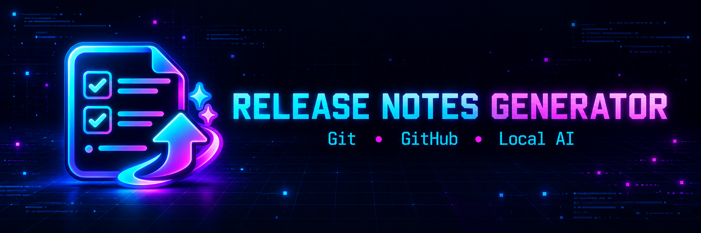

# 🚀 Release Notes Generator


[](https://github.com/petrsafrata/ReleaseNotesGenerator/actions/workflows/ci-release.yml)
[](https://github.com/petrsafrata/ReleaseNotesGenerator/actions/workflows/docs.yml)


---

## 🧾 Project Description

Release Notes Generator is a local-first Java application that creates structured Markdown release notes from changes in a Git repository.

It resolves a release range, reads commits, categorizes changes, and renders a Markdown document. Optional GitHub integration enriches the result with pull request metadata, while optional Ollama integration improves summaries and descriptions using a locally managed AI model.

The application provides two interfaces:

- a script-friendly command-line interface powered by Picocli
- an interactive terminal interface with guided menus, keyboard navigation, progress information, and Ollama management

Release Notes Generator does not include analytics, telemetry, advertising, user accounts, or a developer-controlled backend. GitHub and AI communication are disabled unless the user explicitly enables the corresponding integration.

---

## ✨ Features

### 📝 Git-Based Release Notes

- Generates release notes between two Git references
- Uses `HEAD` as the default target reference
- Resolves the previous tag automatically when `--from` is omitted
- Reads commit hashes, messages, authors, and dates
- Groups changes into clear Markdown sections
- Writes output to the terminal or a selected file

### 🗂️ Change Categorization

Commit messages are categorized into sections such as:

- Features
- Bug Fixes
- Performance
- Documentation
- Refactoring
- Build System
- CI/CD
- Tests
- Internal Changes
- Other Changes

When GitHub enrichment is enabled, pull request labels can refine the resulting category.

### 🐙 Optional GitHub Enrichment

GitHub enrichment can associate commits with pull requests and add:

- pull request titles and numbers
- links to pull requests
- pull request authors
- repository information
- labels used for categorization

The integration is disabled by default and requires a token provided through the `GITHUB_TOKEN` environment variable.

### 🤖 Optional Local AI Improvement

Ollama can improve the generated release notes by:

- creating a concise release summary
- rewriting individual change descriptions
- producing output in the selected language
- preserving the original set and category of changes through structured validation

The default model is `gemma3:4b`, and the default Ollama endpoint is `http://localhost:11434`.

AI processing is disabled by default. The application never sends the GitHub token to Ollama.

### 🐳 Ollama Management

The application can manage a local Ollama Docker container:

- create and start the container
- show its current status
- stop the container
- list installed models
- download a model

Models are preserved in the Docker volume `release-notes-ollama-data`.

### 🖥️ Interactive Terminal Interface

Starting the application without arguments opens the TUI, which provides:

- a guided release-note generation workflow
- selectable Git references and tags
- GitHub and AI configuration
- Ollama service and model management
- command mode with Picocli completion
- navigation back with `Esc`
- colored status, progress, and result screens

### 🔒 Local-First and Privacy-Focused

- Git processing runs locally
- GitHub and Ollama integrations are opt-in
- No analytics, telemetry, advertising, or tracking is included
- No developer-controlled server receives repository data
- GitHub tokens are read from an environment variable and are not stored by the application
- Generated files remain at a path selected by the user
- Diagnostic logs are controlled by the local Log4j2 configuration

See [PRIVACY.md](PRIVACY.md) for complete information about processed data, optional integrations, storage, retention, and security.

---

## 🧱 Technology and Architecture

- **Language:** Java 21
- **Build tool:** Maven
- **CLI framework:** Picocli
- **Terminal interface:** JLine and JLine ConsoleUI
- **JSON processing:** Jackson
- **Logging:** Log4j2
- **Boilerplate reduction:** Lombok
- **Testing:** JUnit 5 and Mockito
- **Git integration:** Local Git executable
- **GitHub integration:** GitHub REST API
- **AI integration:** Ollama HTTP API
- **Local AI runtime:** Docker and Ollama

| Component | Responsibility |
|---|---|
| CLI and TUI | Collect input, execute workflows, and present results |
| Generation service | Coordinates the complete release-note pipeline |
| Git services | Resolve repositories, tags, ranges, and commits |
| Release services | Categorize, enrich, and render changes |
| GitHub services | Resolve the repository and load pull request metadata |
| AI services | Build prompts, validate structured output, and apply improvements |
| Ollama client | Communicate with the local or configured Ollama API |
| Docker service | Manage the local Ollama container |
| Output writer | Write generated Markdown to the selected destination |

### 🔄 Generation Pipeline

```text
Git repository
      │
      ▼
Resolve release range
      │
      ▼
Load and categorize commits
      │
      ├── Optional GitHub enrichment
      │
      ├── Optional Ollama improvement
      │
      ▼
Validate and render Markdown
      │
      ▼
Terminal or output file
```

Optional integrations enrich an existing local result. They do not replace Git as the source of release changes.

---

## 📁 Project Structure

```text
ReleaseNotesGenerator/
├── .github/
│   ├── dependabot.yml
│   └── workflows/
├── docs/
│   ├── getting-started/
│   ├── images/
│   ├── integrations/
│   ├── legal/
│   ├── architecture.md
│   ├── development.md
│   ├── index.md
│   └── troubleshooting.md
├── src/
│   ├── main/
│   │   ├── java/cz/jpmad/
│   │   │   ├── ReleaseNotesApplication.java
│   │   │   └── releasenotes/
│   │   │       ├── ai/
│   │   │       ├── cli/
│   │   │       ├── config/
│   │   │       ├── docker/
│   │   │       ├── generation/
│   │   │       ├── git/
│   │   │       ├── github/
│   │   │       ├── output/
│   │   │       ├── release/
│   │   │       └── tui/
│   │   └── resources/
│   └── test/
├── CONTRIBUTING.md
├── LICENSE
├── PRIVACY.md
├── RELEASE-NOTES.md
├── VERSION
├── mkdocs.yml
└── pom.xml
```

The executable JAR is generated as `target/release-notes.jar`.

---

## 🚀 Installation

### 📥 Install from GitHub Releases

1. Install Java 21 or newer.
2. Open the [GitHub Releases](https://github.com/petrsafrata/ReleaseNotesGenerator/releases) page.
3. Download `release-notes.jar` from the latest release.
4. Store it in a permanent directory.
5. Run the application from a Git repository.

Windows PowerShell:

```powershell
java -jar C:\Tools\release-notes.jar
```

Linux or macOS:

```bash
java -jar ~/tools/release-notes.jar
```

Running the JAR without arguments opens the interactive terminal interface.

> [!NOTE]
> The release JAR contains the application dependencies, but Java, Git, and optional external tools such as Docker must be installed separately.

### 🔧 Requirements

| Requirement | When needed |
|---|---|
| Java 21 or newer | Always |
| Git | Always |
| GitHub token | Only for GitHub enrichment |
| Docker | For application-managed local Ollama |
| Ollama model | Only for AI improvement |

### 🗑️ Uninstallation

Delete the downloaded JAR and any generated output or log files you no longer need.

If the application created the Ollama container and you also want to remove its persisted models, use Docker to remove the container and the `release-notes-ollama-data` volume. Removing the volume permanently deletes downloaded Ollama models.

---

## ▶️ Usage

### Interactive Terminal Interface

Start the application without arguments:

```powershell
java -jar release-notes.jar
```

Use the arrow keys to select an action and `Esc` to return from supported screens.

### Command-Line Interface

Show help:

```powershell
java -jar release-notes.jar --help
```

Show the installed version:

```powershell
java -jar release-notes.jar --version
```

Generate release notes using the previous tag and `HEAD`:

```powershell
java -jar release-notes.jar generate
```

Generate release notes for an explicit range:

```powershell
java -jar release-notes.jar generate --from v0.1.0 --to HEAD
```

Write the result to a file:

```powershell
java -jar release-notes.jar generate --output RELEASE-NOTES.md
```

Enable GitHub enrichment:

```powershell
java -jar release-notes.jar generate --github
```

Enable local AI improvement:

```powershell
java -jar release-notes.jar generate --ai --model gemma3:4b --language en
```

Use GitHub and Ollama together:

```powershell
java -jar release-notes.jar generate `
    --github `
    --ai `
    --model gemma3:4b `
    --language en `
    --output RELEASE-NOTES.md
```

> [!TIP]
> Run `java -jar release-notes.jar generate --help` to see the complete and authoritative option list for the installed version.

---

## ⚙️ Configuration

### 🔑 GitHub Token

GitHub enrichment reads a token from the `GITHUB_TOKEN` environment variable. Use a fine-grained personal access token restricted to the required repositories and minimum read permissions.

Set the token temporarily in the current PowerShell process:

```powershell
$secureToken = Read-Host "Fine-grained GitHub token" -AsSecureString
$env:GITHUB_TOKEN = [System.Net.NetworkCredential]::new("", $secureToken).Password
```

Run generation in the same terminal:

```powershell
java -jar release-notes.jar generate --github
```

Remove the variable before closing the terminal if desired:

```powershell
Remove-Item Env:GITHUB_TOKEN
```

The process-scoped variable disappears automatically when that PowerShell process closes.

> [!WARNING]
> Treat the token as a password. Never place it directly in a command, commit, configuration file, screenshot, generated release notes, log, or bug report.

### 🤖 Ollama

Start the application-managed Ollama container:

```powershell
java -jar release-notes.jar ai start
```

Show its status:

```powershell
java -jar release-notes.jar ai status
```

Download the default model:

```powershell
java -jar release-notes.jar ai pull gemma3:4b
```

List installed models:

```powershell
java -jar release-notes.jar ai models
```

Stop the container:

```powershell
java -jar release-notes.jar ai stop
```

The default API endpoint is:

```text
http://localhost:11434
```

A different endpoint can be selected with `--ollama-url`:

```powershell
java -jar release-notes.jar generate `
    --ai `
    --ollama-url https://ollama.example.com `
    --model gemma3:4b
```

> [!IMPORTANT]
> When a custom Ollama URL points to another computer or service, structured release data leaves the local machine and is subject to the endpoint operator's policies.

### 🌍 AI Output Language

Select the release-note language with `--language`:

```powershell
java -jar release-notes.jar generate --ai --language cs
```

The default language is `en`.

### 📄 Output File

Without `--output`, Markdown is written to standard output. With `--output`, the generated document is saved to the selected path:

```powershell
java -jar release-notes.jar generate --output docs/release-notes.md
```

Progress and diagnostic messages are written separately from the generated Markdown.

---

## 🛠️ Local Development

### Prerequisites

- JDK 21
- Git
- Docker Desktop or Docker Engine for Ollama integration testing
- Python for local MkDocs documentation builds

Clone the repository:

```powershell
git clone https://github.com/petrsafrata/ReleaseNotesGenerator.git
cd ReleaseNotesGenerator
```

Run tests and verification:

```powershell
.\mvnw.cmd -B clean verify
```

Build the executable JAR:

```powershell
.\mvnw.cmd -B clean package
```

Run the built application:

```powershell
java -jar target\release-notes.jar
```

Linux or macOS equivalents:

```bash
./mvnw -B clean verify
./mvnw -B clean package
java -jar target/release-notes.jar
```

### Documentation

Install documentation dependencies and run a local server:

```powershell
py -m pip install -r requirements-docs.txt
py -m mkdocs serve
```

Build the documentation with strict validation:

```powershell
py -m mkdocs build --strict
```

The published documentation is available at:

https://petrsafrata.github.io/ReleaseNotesGenerator/

---

## 🔒 Security

Release Notes Generator follows a local-first and least-exposure design:

- Git commands are executed as structured process arguments rather than shell command strings
- Repository data is processed locally unless an optional integration is enabled
- GitHub tokens are read only from `GITHUB_TOKEN`
- Tokens are used only in GitHub authorization headers
- Tokens are not intentionally written to logs, output files, Ollama requests, or generated Markdown
- GitHub and Ollama responses are parsed and validated before use
- AI responses must contain the same change identifiers as the original request
- Missing, duplicated, or invented changes are rejected
- HTTP requests use explicit connection and operation timeouts
- Interrupted operations restore the thread interruption flag
- No analytics, telemetry, advertising, or developer-controlled data collection is included

Use HTTPS when connecting to a remote Ollama endpoint, keep tokens process-scoped where practical, and review generated release notes before publishing them.

See [PRIVACY.md](PRIVACY.md) for data-handling details and [CONTRIBUTING.md](CONTRIBUTING.md) for security requirements applying to contributions.

---

## 🧯 Troubleshooting

### The application does not start

- Confirm that Java 21 or newer is installed with `java --version`
- Confirm that the downloaded file is a complete release JAR
- Use an explicit Java executable path if multiple JDKs are installed

Windows example:

```powershell
& "C:\Program Files\Java\jdk-21\bin\java.exe" -jar release-notes.jar
```

### The current directory is not a Git repository

Run the application from the repository for which release notes should be generated:

```powershell
cd D:\Projects\ExampleRepository
java -jar C:\Tools\release-notes.jar
```

### The release range cannot be resolved

- Confirm that the selected references exist
- Check tags with `git tag --list`
- Specify both references explicitly with `--from` and `--to`
- Remember that automatic previous-tag resolution requires a suitable earlier tag

### GitHub enrichment fails

- Confirm that `GITHUB_TOKEN` is set in the same terminal process
- Confirm that the token has access to the repository
- Confirm that the repository has a supported GitHub `origin` remote
- Check whether the token is expired or revoked
- Retry without `--github` to verify that local generation still works

### Ollama is unavailable

Check the managed service:

```powershell
java -jar release-notes.jar ai status
```

Start it if necessary:

```powershell
java -jar release-notes.jar ai start
```

Also confirm that Docker Desktop or Docker Engine is running and that port `11434` is available.

### The selected model is not installed

```powershell
java -jar release-notes.jar ai pull gemma3:4b
```

Then verify it:

```powershell
java -jar release-notes.jar ai models
```

### AI generation is slow

Generation speed depends on the selected model, CPU, GPU, available memory, repository size, and the number of changes. The first request may also take longer while the model is loaded.

### Terminal output flickers or appears incomplete

- Use a modern terminal such as Windows Terminal
- Confirm that ANSI and interactive input are supported
- Use the non-interactive CLI in terminals that do not support the TUI
- Wait for the result screen before returning to the main menu

> [!WARNING]
> Before publishing logs or terminal output, remove tokens, private repository names, remote URLs, confidential commit or pull request content, and sensitive local paths.

For additional help, see the [troubleshooting documentation](docs/troubleshooting.md).

---

## ⚠️ Current Limitations

- Java 21 or newer is required
- Git must be installed and available to the application
- Automatic range resolution depends on the repository tag history
- GitHub enrichment currently relies on a supported GitHub `origin` remote
- GitHub enrichment requires an appropriately scoped token
- AI output quality and speed depend on the selected Ollama model and available hardware
- Docker is required when the application manages Ollama itself
- Remote Ollama endpoints may process or retain submitted release data
- The application is distributed as a JAR rather than a native platform installer

---

## 🤝 Contributing

Contributions are welcome. Before submitting a pull request, read [CONTRIBUTING.md](CONTRIBUTING.md).

Changes should preserve the project's local-first design, clear CLI behavior, interactive terminal usability, structured AI validation, and absence of hidden data collection.

---

## 📚 Documentation

The complete documentation includes:

- installation and configuration
- GitHub and Ollama integration guides
- architecture and development information
- privacy and security details
- troubleshooting instructions

Read it online at [petrsafrata.github.io/ReleaseNotesGenerator](https://petrsafrata.github.io/ReleaseNotesGenerator/) or browse the [`docs`](docs) directory.

---

## ⚖️ License

Release Notes Generator is open-source software released under the Apache License 2.0. See [LICENSE](LICENSE) for the full license text.

```text
Apache-2.0 – Copyright © 2026 Petr Šafrata
```

Third-party dependencies and components remain subject to their respective licenses and attribution requirements.

---

Thank you for using Release Notes Generator!
