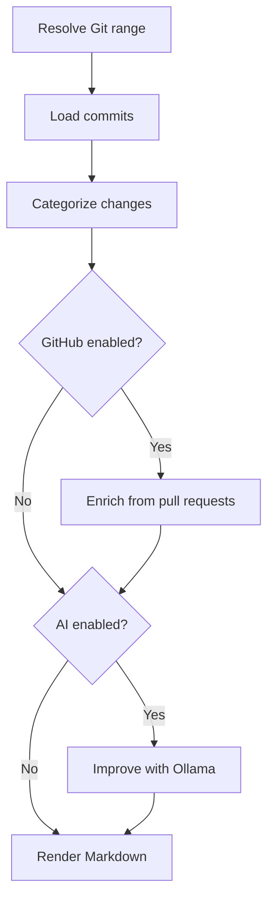

# Architecture

Release Notes Generator separates user interfaces, application orchestration, domain logic, and external integrations.

## Generation pipeline

## Application entry point

`ReleaseNotesApplication` creates the Picocli command tree. With no arguments, it starts the TUI. With arguments, it executes the regular CLI.

## CLI layer

The Picocli command layer:

- Parses arguments
- Creates generation requests
- Reports progress
- Maps failures to process exit codes
- Keeps Markdown on standard output and progress on standard error

`GenerateCommand` delegates release creation to `ReleaseNotesGenerationService`. AI subcommands delegate service creation to `ApplicationServicesFactory`.

## TUI layer

The JLine terminal layer provides:

- Main menu
- Generation workflow
- Ollama management workflow
- Command mode
- Shared header and terminal output handling
- Escape-key navigation

The TUI reuses the same command and service layers instead of duplicating release-generation logic.

## Generation service

`ReleaseNotesGenerationService` coordinates:

1. Repository inspection
2. Release range resolution
3. Commit loading
4. Change categorization
5. Optional GitHub enrichment
6. Optional AI improvement
7. Markdown rendering

Progress is exposed through a listener, keeping presentation details outside the service.

## Git integration

The Git package executes Git commands and parses repository information, tags, and commits.

`GitCommandExecutor` owns process execution. Higher-level services build Git arguments and interpret results.

## GitHub integration

The GitHub package:

- Parses the `origin` remote
- Reads `GITHUB_TOKEN`
- Calls the GitHub API
- Parses repository and pull request responses
- Associates commits with pull requests
- Applies pull request metadata to release changes

## AI and Ollama integration

The generic AI package builds structured requests, loads prompts and JSON schemas, validates responses, and maps rewritten descriptions back to original changes.

The Ollama package implements the HTTP transport and Ollama-specific request and response records.

!!! info "Stable identifiers"
    Every change receives a deterministic identifier. AI responses must return the same set exactly once, preventing silent omission or invention of release items.

## Docker integration

The Docker package manages the dedicated Ollama container through explicit Docker commands. It distinguishes between a missing, stopped, and running container.

## Composition root

`ApplicationServicesFactory` creates shared Jackson and HTTP infrastructure and wires application services without a dependency-injection framework.

## Design principles

- Local generation works without external services
- GitHub and AI remain optional and isolated
- CLI and TUI share application behavior
- External data is parsed into explicit records
- Invalid AI responses fail before rendering
- Small interfaces are introduced where test substitution provides value
- User-facing errors remain concise while technical details are logged
