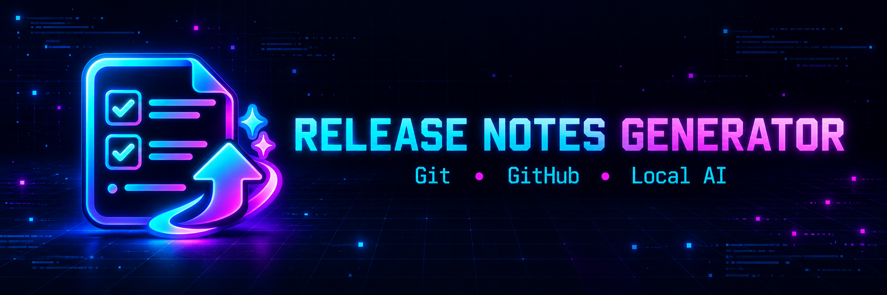

# Release Notes Generator

Release Notes Generator is a local-first Java application that creates structured Markdown release notes from Git history.

It can enrich changes with GitHub pull request data and improve the final wording with a locally running Ollama model. Both integrations are optional.

## Main features

- Interactive terminal interface and script-friendly CLI
- Automatic release range resolution from Git tags
- Categorization based on conventional commits and pull request labels
- GitHub pull request titles, links, authors, and labels
- Local AI summaries and consistent descriptions through Ollama
- Managed Ollama Docker container with persistent model storage
- Markdown output to the terminal or a selected file
- No telemetry or developer-controlled backend

## Get started

1. [Install the application](getting-started/installation.md).
2. [Configure a release range and generate your first notes](getting-started/configuration.md).
3. Optionally enable [GitHub enrichment](integrations/github.md) or [local AI](integrations/ollama.md).

!!! info "Local-first by default"
    Basic generation reads the current Git repository and creates Markdown locally. GitHub and Ollama are contacted only when their integrations are explicitly enabled.

!!! info "Independent project"
    Release Notes Generator is an independent open-source project and is not affiliated with, sponsored by, or endorsed by GitHub or Ollama.

## Project links

- [GitHub repository](https://github.com/petrsafrata/ReleaseNotesGenerator)
- [Latest releases](https://github.com/petrsafrata/ReleaseNotesGenerator/releases)
- [Contributing guidelines](https://github.com/petrsafrata/ReleaseNotesGenerator/blob/master/CONTRIBUTING.md)
- [Privacy policy](legal/privacy.md)
